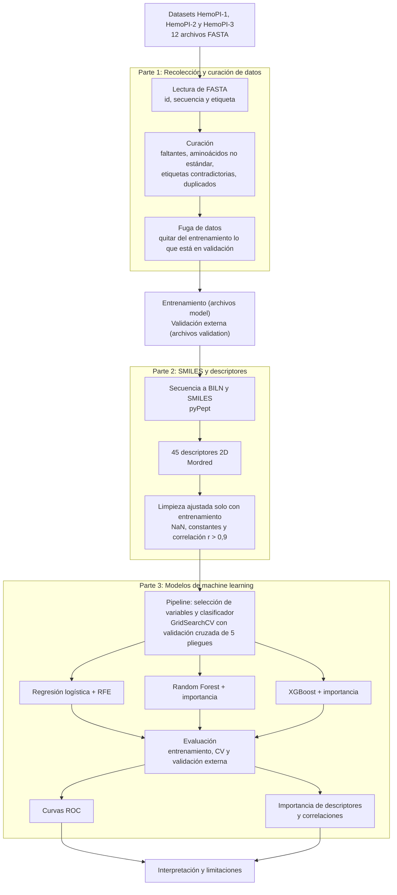

# hemolytic-activity-ml-prediction

## Estudiante: Samuel Salazar Diaz

Predicción de actividad hemolítica en péptidos bioactivos mediante descriptores fisicoquímicos y modelos de machine learning, con análisis e interpretación de las variables más influyentes.

Trabajo desarrollado para la **Actividad 1** del Programa Superior Universitario en Bioinformática Aplicada al Desarrollo de Fármacos: *Modelado predictivo de actividad hemolítica mediante aprendizaje automático*. Está basado en los conjuntos de datos **HemoPI-1, HemoPI-2 y HemoPI-3** del artículo de Plisson et al. (2020).

## Resumen del flujo de trabajo

Todo el análisis se ejecutó en **Google Colab** vinculado a **Google Drive**, en tres notebooks consecutivos. Cada notebook lee las salidas del anterior.



## Datos

Los datasets provienen del repositorio de GitHub asociado al artículo de Plisson et al. (2020), indicado en su sección de disponibilidad de datos. Cada carpeta contiene 4 archivos FASTA:

| Archivo | Contenido | Uso en este trabajo |
|---|---|---|
| `HemoPI-X_model_class0.fasta` | Péptidos de clase 0 | Entrenamiento |
| `HemoPI-X_model_class1.fasta` | Péptidos de clase 1 | Entrenamiento |
| `HemoPI-X_validation_class0.fasta` | Péptidos de clase 0 | Validación externa (20 %) |
| `HemoPI-X_validation_class1.fasta` | Péptidos de clase 1 | Validación externa (20 %) |

En total son 12 archivos (3 datasets × 4). `class0` se codifica como `label = 0` y `class1` como `label = 1`. En el artículo, HemoPI-1 distingue péptidos hemolíticos de no hemolíticos, mientras que HemoPI-2 y HemoPI-3 se usan para predecir potencia hemolítica alta o baja. Los tres datasets se analizan de forma **independiente**.

## Estructura del repositorio

```
hemolytic-activity-ml-prediction/
├── README.md
├── notebooks/
│   ├── Act1_Parte1_Curacion_HemoPI.ipynb
│   ├── Act1_Parte2_SMILES_Mordred_v2.ipynb
│   └── Act1_Parte3_Modelos_ML.ipynb
└── Act1_PSU/                        # misma estructura que en Google Drive
    ├── HemoPI-1/                    # datos originales (4 FASTA)
    ├── HemoPI-2/
    ├── HemoPI-3/
    ├── datos_procesados/            # salida de la Parte 1
    ├── descriptores/                # salida de la Parte 2
    └── resultados_modelos/          # salida de la Parte 3
        ├── modelos/
        ├── tablas/
        └── figuras/
```

## Descripción de los notebooks

### Parte 1: `Act1_Parte1_Curacion_HemoPI.ipynb`
Recolección y curación de los datos peptídicos.

1. Monta Google Drive y comprueba que existan los 12 archivos FASTA.
2. Lee los FASTA y construye una tabla con `dataset`, `split`, `peptide_id` (línea `>`), `sequence`, `label` y `activity`.
3. Une los archivos `model` (clase 0 y 1) como **entrenamiento** y los `validation` como **validación externa**, por separado para cada dataset.
4. Cura los datos, con un registro de las filas eliminadas en cada paso:
   - valores faltantes o secuencias vacías;
   - secuencias con aminoácidos no estándar;
   - secuencias con etiquetas contradictorias;
   - duplicados exactos;
   - secuencias presentes a la vez en entrenamiento y validación (se quitan del entrenamiento para evitar fuga de datos).
5. Genera gráficos de balance de clases y de longitud de secuencias.

**Salidas** (`Act1_PSU/datos_procesados/`): `HemoPI-X_train.csv`, `HemoPI-X_validation.csv` y `registro_curacion.csv`.

### Parte 2: `Act1_Parte2_SMILES_Mordred_v2.ipynb`
Conversión de secuencias a SMILES y cálculo de descriptores fisicoquímicos.

1. Convierte cada secuencia a **SMILES** con **pyPept** (secuencia → BILN → molécula RDKit → SMILES). Incluye un parche de compatibilidad con versiones recientes de pandas.
2. Calcula con **Mordred** un subconjunto de **45 descriptores 2D**, agrupados en seis categorías: tamaño y composición, lipofilia y refractividad, polaridad y puentes de hidrógeno, ionizables y carga parcial, topología y forma, y polarizabilidad. Se seleccionaron a criterio porque calcular los 1613 descriptores de Mordred resultaba muy lento y pesado.
3. Limpia los descriptores, ajustando todo **solo con el entrenamiento**: se eliminan los descriptores con más de 5 % de valores faltantes, los constantes y los de alta correlación (|r| > 0,9). Se protegen `MW`, `SLogP`, `nHBDon` y `nHBAcc`, equivalentes en Mordred de `MolWt`, `MolLogP`, `NumHDonors` y `NumHAcceptors`.

**Salidas** (`Act1_PSU/descriptores/`):
- `HemoPI-X_train_smiles.csv` y `HemoPI-X_validation_smiles.csv`;
- `HemoPI-X_train_descriptores_crudo.csv` y `HemoPI-X_valid_descriptores_crudo.csv`, que son la caché del cálculo;
- `HemoPI-X_train_descriptores.csv` y `HemoPI-X_validation_descriptores.csv`, que son las tablas finales;
- `HemoPI-X_descriptores_seleccionados.txt` y `resumen_filtrado_descriptores.csv`.

### Parte 3: `Act1_Parte3_Modelos_ML.ipynb`
Construcción, evaluación e interpretación de los modelos.

1. Entrena **3 algoritmos** en cada dataset, con selección de variables dentro de un `Pipeline`:

   | Modelo | Selección de variables |
   |---|---|
   | Regresión logística (con escalado) | RFE (eliminación recursiva) |
   | Random Forest | Selección por importancia (`SelectFromModel`) |
   | XGBoost | Selección por importancia (`SelectFromModel`) |

2. Ajusta hiperparámetros y el número de descriptores con `GridSearchCV` y validación cruzada estratificada de 5 pliegues (refit por AUC-ROC).
3. Evalúa en tres niveles: entrenamiento, validación cruzada y validación externa (20 %). Métricas: accuracy, precision, recall, especificidad, F1, AUC-ROC, MCC y kappa de Cohen, con intervalos bootstrap para AUC y MCC en la validación externa.
4. Genera las curvas ROC, el top 10 de descriptores más importantes por modelo y el análisis de correlaciones entre los descriptores seleccionados.
5. Guarda el modelo final y los pesos o importancias de los descriptores.

**Salidas** (`Act1_PSU/resultados_modelos/`):
- `modelos/`: `HemoPI-X_<modelo>_modelo_final.joblib` y `HemoPI-X_<modelo>_gridsearch.joblib`.
- `tablas/`: métricas, hiperparámetros, importancias, descriptores consistentes entre modelos y pares correlacionados.
- `figuras/`: `curvas_roc.png`, `top10_importancias.png` y `correlacion_HemoPI-X.png`.

## Cómo ejecutarlo

Los notebooks se ejecutaron en **Google Colab** con la carpeta `Act1_PSU` almacenada en Google Drive (`/content/drive/MyDrive/Act1_PSU`).

1. Copia la carpeta `Act1_PSU` a tu Google Drive, en la raíz de *Mi unidad*.
2. Abre cada notebook en Colab (*Archivo → Subir cuaderno*) y ejecútalos **en orden**: Parte 1, Parte 2 y Parte 3.
3. Acepta el montaje de Drive cuando Colab lo solicite.
4. Si guardas la carpeta en otra ruta, cambia la variable `BASE_DIR` en la primera celda de configuración de cada notebook.

Los cálculos más lentos (descriptores de la Parte 2 y `GridSearchCV` de la Parte 3) se guardan en Drive. Si se corta la sesión, al volver a ejecutar se cargan sin recalcular. Para forzar el reentrenamiento de la Parte 3, pon `RECALCULAR = True`.

## Requerimientos

Entorno: Google Colab (Python 3). Las librerías se instalan en los propios notebooks.

| Librería | Uso |
|---|---|
| `pandas`, `numpy` | Manejo de datos |
| `matplotlib`, `seaborn` | Gráficos |
| `rdkit` | Manejo de moléculas y SMILES |
| `pyPept` | Conversión de secuencias a SMILES (se instala desde GitHub: `pip install git+https://github.com/Boehringer-Ingelheim/pyPept.git`) |
| `mordredcommunity` | Descriptores moleculares (fork mantenido de Mordred, se importa como `mordred`) |
| `scikit-learn` | Modelos, validación cruzada, selección de variables y métricas |
| `xgboost` | Modelo XGBoost |
| `joblib` | Guardado de modelos |
| `tqdm` | Barras de progreso |

> Versiones: completar con las del entorno de Colab usado, que se pueden obtener con `!pip list | grep -i -E "pandas|numpy|scikit-learn|xgboost|rdkit|mordred|pypept|seaborn|matplotlib"`.

## Resultados

> Completar tras la ejecución final: tabla de métricas en validación externa por dataset y modelo (`tablas/metricas_todos_los_niveles.csv`) y figuras de `figuras/`.

| Dataset | Modelo | AUC-ROC (CV) | AUC-ROC (externa) | MCC (externa) |
|---|---|---|---|---|
| HemoPI-1 | Regresión logística | | | |
| HemoPI-1 | Random Forest | | | |
| HemoPI-1 | XGBoost | | | |

## Limitaciones

- Los descriptores son **2D** (calculados desde el SMILES): no codifican el orden de la secuencia ni la estructura secundaria.
- Se usó un subconjunto de 45 descriptores elegidos a criterio, y el filtro de correlación conserva el primer descriptor de cada grupo redundante, no el más informativo.
- La validación externa es una partición aleatoria de la misma fuente: péptidos de secuencia parecida pueden quedar a ambos lados del corte.
- El tamaño de muestra es moderado, por lo que las diferencias pequeñas entre modelos pueden no ser significativas.
- La importancia de variables indica asociación estadística, no causalidad.

## Referencias

- Plisson, F., Ramírez-Sánchez, O., & Martínez-Hernández, C. (2020). Machine learning-guided discovery and design of non-hemolytic peptides. *Scientific Reports, 10*, 16581. https://doi.org/10.1038/s41598-020-73644-6
- Ochoa, R., Brown, J. B., & Fox, T. (2023). pyPept: a python library to generate atomistic 2D and 3D representations of peptides. *Journal of Cheminformatics, 15*, 79. https://doi.org/10.1186/s13321-023-00748-2
- Moriwaki, H., Tian, Y.-S., Kawashita, N., & Takagi, T. (2018). Mordred: a molecular descriptor calculator. *Journal of Cheminformatics, 10*, 4. https://doi.org/10.1186/s13321-018-0258-y